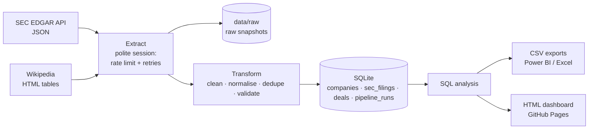

# M&A Deal Tracker

An automated, multi-source data pipeline that collects mergers & acquisitions (M&A) data from the web, cleans and standardises it, stores it in a SQL database, and publishes an interactive dashboard plus CSV exports ready for Power BI.

**Live dashboard:** `https://<your-username>.github.io/mna-deal-tracker/` *(after enabling GitHub Pages; see below)*

   

---

## What it does

| Stage | What happens | Tools |
|---|---|---|
| **Extract** | Pulls M&A-related filings for a watchlist of 20 public companies from the **SEC EDGAR JSON API**, and scrapes historical deal tables from **Wikipedia** HTML | `requests`, `BeautifulSoup`, `lxml` |
| **Transform** | Strips footnotes, parses deal values in mixed units (millions / billions / trillions), normalises company names so the same company matches across sources, removes duplicates, validates values | `pandas`, regex |
| **Load** | Idempotent upserts into a normalised **SQLite** schema; every run is logged with a data-quality report | `sqlite3`, SQL |
| **Report** | SQL analysis queries, CSV exports for **Power BI / Excel**, and a static interactive HTML dashboard | SQL, `Plotly` |
| **Automate** | Weekly scheduled run on **GitHub Actions**, plus a Linux shell runner with a lock file for cron | GitHub Actions, Bash |



## Engineering highlights

- **Two different source types:** a JSON API and messy HTML. The Wikipedia parser expands `rowspan`/`colspan` into a grid, finds columns by keyword (so it survives renamed headers), ignores inflation-adjusted columns, and reads units from the header text.
- **Responsible scraping:** a custom `PoliteSession` identifies itself with a `User-Agent`, enforces a minimum delay between requests (well under SEC's 10 req/s limit), and retries 429/5xx responses with exponential backoff.
- **Fault isolation:** if one company or one source fails, the error is logged and the rest of the run continues.
- **Cross-source entity matching:** `company_key()` normalises names (`"Tyrell Corp."` and `"Tyrell Corporation"` → `tyrell`), so historical deals can be joined to current SEC activity.
- **Data quality is visible, not silent:** each cleaning step records what it dropped or fixed (missing values, implausible values, duplicates, bad dates). Results are stored in `pipeline_runs` and shown on the dashboard.
- **Idempotent loads:** `INSERT … ON CONFLICT DO UPDATE` keyed on SEC accession numbers and deal IDs, so re-running never creates duplicates (covered by a test).
- **Reproducible raw data:** every live run saves the raw JSON/HTML to `data/raw/`, so parsing can be re-run without hitting the sources again.
- **Tested offline:** 22 `pytest` tests run against fixture files, so CI never depends on external websites.

## Quick start

```bash
git clone https://github.com/<your-username>/mna-deal-tracker.git
cd mna-deal-tracker
make install                 # creates .venv and installs requirements
source .venv/bin/activate

make test                    # run the test suite
make demo                    # offline run on the fictional sample fixtures

export SEC_USER_AGENT="Your Name your.email@example.com"   # required by SEC
make run                     # live run: SEC EDGAR + Wikipedia
```

Open `docs/index.html` in a browser to view the dashboard. CSV files land in `data/exports/`.

Run a single source: `python -m mna_tracker.pipeline --sources sec`

## Data model

| Table | Grain | Key |
|---|---|---|
| `companies` | one row per company | `company_key` (normalised name) |
| `sec_filings` | one row per M&A-related SEC filing | `accession` |
| `deals` | one row per historical deal | `deal_id` = acquirer + target + year |
| `pipeline_runs` | one row per source per run, with data-quality JSON | `run_id` |

**Which SEC filings count as M&A?** Merger registrations (`S-4`), merger communications (`425`), merger proxies (`DEFM14A`, `PREM14A`, `DEFM14C`), tender offers (`SC TO-T`, `SC 14D9`) and 8-K filings reporting **Item 2.01, Completion of Acquisition or Disposition of Assets**. The mapping lives in `mna_tracker/config.py`.

Example query (from `sql/analysis.sql`):

```sql
SELECT c.display_name AS company, COUNT(*) AS mna_filings,
       SUM(CASE WHEN f.event_type LIKE 'Acquisition completed%' THEN 1 ELSE 0 END) AS completed_acquisitions
FROM sec_filings f
JOIN companies c USING (company_key)
GROUP BY c.company_key
ORDER BY mna_filings DESC;
```

## Using the data in Power BI

1. **Get Data → Text/CSV** and load `companies.csv`, `sec_filings.csv` and `deals.csv` from `data/exports/`.
2. In **Model view**, relate `companies[company_key]` 1→* `sec_filings[company_key]` and `companies[company_key]` 1→* `deals[acquirer_key]`.
3. The `analysis_*.csv` files are pre-aggregated views if you want quick visuals without building measures.

## Automation

- **GitHub Actions** (`.github/workflows/pipeline.yml`): tests run on every push; every Monday the live pipeline runs, and the refreshed dashboard and CSV exports are committed back to the repo. Logs and the database are uploaded as a build artifact.
  - Add a repository secret `SEC_USER_AGENT` (Settings → Secrets and variables → Actions).
  - Enable Pages: Settings → Pages → Deploy from branch → `main` / `/docs`.
- **Linux cron:** `scripts/run_pipeline.sh` uses `flock` to prevent overlapping runs and returns a non-zero exit code on failure.

## Project structure

```
mna-deal-tracker/
├── mna_tracker/
│   ├── config.py           # paths, watchlist, M&A form mapping
│   ├── http.py             # PoliteSession: User-Agent, rate limit, retries
│   ├── scrapers/
│   │   ├── sec_edgar.py    # Source 1: SEC EDGAR JSON API
│   │   └── wikipedia.py    # Source 2: HTML table scraping
│   ├── transform.py        # cleaning, normalisation, validation reports
│   ├── load.py             # SQLite upserts + run logging
│   ├── report.py           # SQL analysis, CSV exports, HTML dashboard
│   └── pipeline.py         # CLI entry point
├── sql/                    # schema.sql, analysis.sql
├── tests/                  # pytest suite + fixtures (fictional sample data)
├── scripts/run_pipeline.sh # cron-friendly runner
├── docs/index.html         # generated dashboard (served by GitHub Pages)
└── .github/workflows/      # CI + weekly scheduled refresh
```

## Notes on the data

- The files in `tests/fixtures/` are **fictional** and exist only for tests and the offline demo. The demo dashboard shows a banner saying so.
- Deal values are nominal USD as published by the source and have not been independently verified.
- Data is collected from public sources in line with their access policies: SEC's fair-access guidelines and Wikipedia's terms of use.

## Roadmap

- Add a JavaScript-rendered source with Playwright
- Parse the 8-K filing text to extract target names and deal values
- Move storage to PostgreSQL and orchestrate with Airflow or Prefect
- Publish a Power BI report built on the exported model
